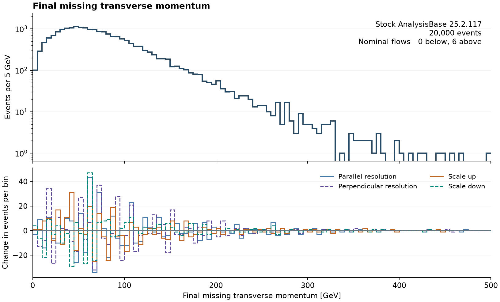
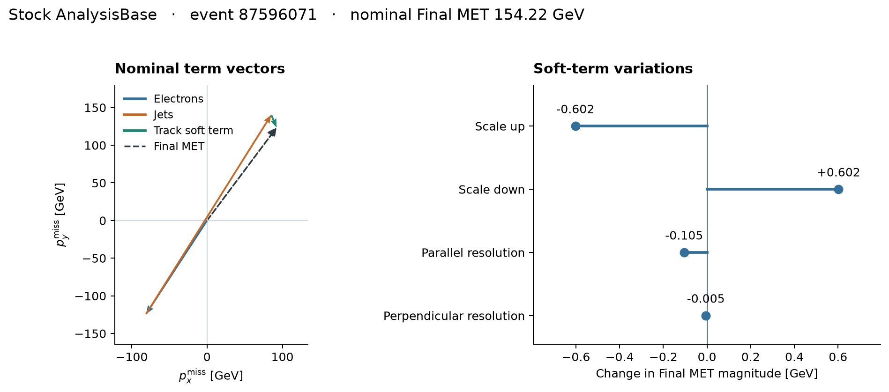
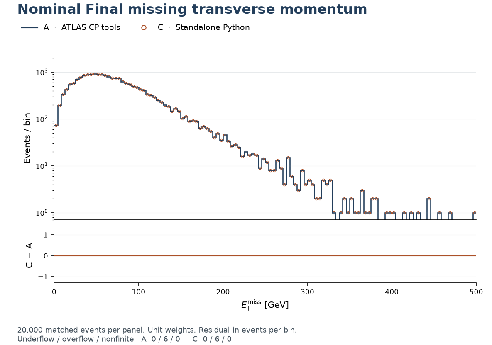
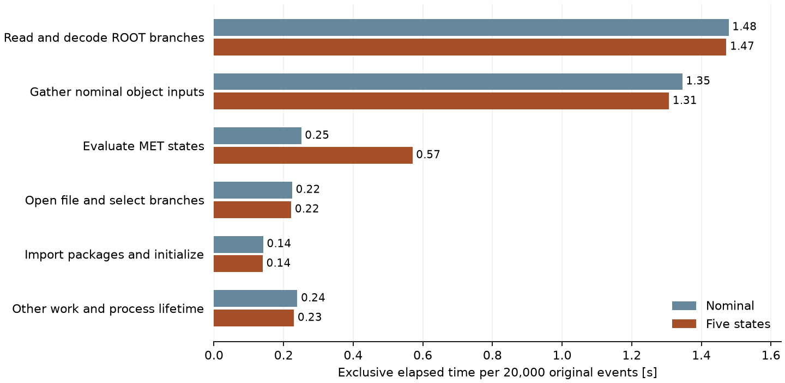
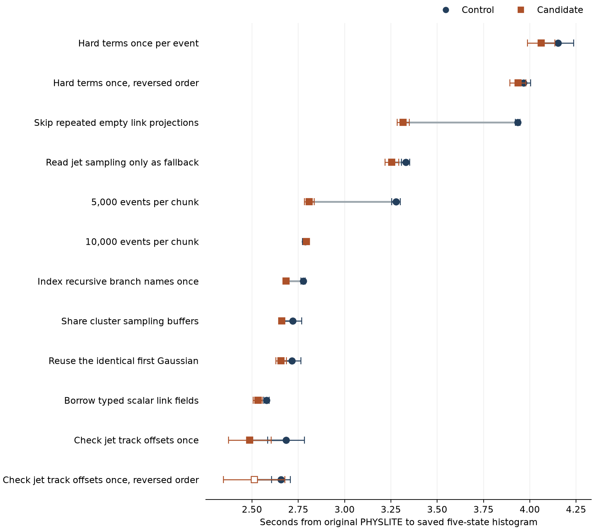

# Missing transverse momentum from PHYSLITE with CorrectionLib

**The delivered standalone calculation was 8.99 times faster than stock AnalysisBase for the five-state MET workflow.** On 20,000 simulated top-pair events, the stock CP tools in AnalysisBase 25.2.117 (A), the CorrectionLib replacement inside AnalysisBase (B) and the standalone Python analysis (C) produced exactly the same eight MET terms and four Final significance quantities for nominal and all four recommended track soft-term variations. Each job started from the same original PHYSLITE file. The three saved histograms were byte-identical. The standalone calculation also reproduced the original selections, ordered constituent links and Gaussian values. [Stock configuration](evidence/reference/full/reference-smoke.yaml) · [Framework comparison](evidence/components/framework-frozen/rich-full/comparison.json) · [Delivered standalone physics](evidence/offset-final/acceptance/full/compare.json) · [Saved histogram comparison](evidence/offset-final/acceptance/full/comparison.json)

Final MET combines the reconstructed hard-object terms and the corrected track soft term. The stored-core control reads the input track soft term directly. A and B write and then histogram an ntuple. C fills the histogram directly from PHYSLITE.

| Workload, original file through saved histogram | A · Stock total (s) | B · Framework replacement total (s) | C · Delivered standalone total (s) | Qualified A/C | Timing qualification |
| --- | ---: | ---: | ---: | ---: | --- |
| Stored core track soft term | 5.484 ± 0.146 | — | 0.494 ± 0.011 | 11.10× | Both paths qualified for this stored-term control. |
| Nominal Final MET | 19.709 ± 0.158 | 19.855 ± 0.139 | 2.235 ± 0.007 | — | B and C qualified. A failed the process check. |
| Five MET states | **22.685 ± 0.458** | **22.939 ± 0.451** | **2.525 ± 0.042** | **8.99×** | All three paths qualified for full reconstruction and significance. |

Each row uses one matched cohort on CPU 0. The entries are arithmetic means ± sample standard deviations of three retained runs after a warm-up. The spread limits were a relative sample SD ≤ 5% and a maximum deviation of 10% from the retained median. Every launch also had to use a single analysis thread on the fixed CPU and save the expected output. During the stock nominal warm-up, ROOT’s Cling interpreter started a compiler process to locate its include directories. All three retained stock nominal runs passed individually. The frozen process rule applies to all four launches even though only the last three enter the mean, so the nominal stock series failed qualification. The nominal stock-to-standalone speedup and nominal framework adoption ratio therefore remain inconclusive. The **8.99×** full result falls short of the 10× aspiration. The separately measured **11.10×** applies only to reading the stored core track soft term. [All measured times and qualification decisions](evidence/offset-final/timing/summary.json) · [Raw process records](evidence/offset-final/timing/benchmark.json)

Optimizing the standalone path reduced five-state time from **4.134 ± 0.045 s** for the faithful implementation to **2.525 ± 0.042 s**, a **38.92%** reduction in the same session. Nominal fell from 3.794 ± 0.037 s to 2.235 ± 0.007 s (41.08%). Peak resident memory among the retained delivered runs was 476,964 KiB for five states and 472,396 KiB for nominal. These improvements compare two release-free Python workflows with the same event physics and random stream. [Matched faithful and delivered runs](evidence/offset-final/timing/summary.json) · [Resource observations](evidence/offset-final/timing/benchmark.json)

The five-state **framework adoption ratio was 1.0112** against a budget of 1.20. Stock took 22.421 ± 0.459 s and the framework replacement took 22.672 ± 0.447 s through the written ntuple. The independent histogram leg added 0.265 and 0.267 s, respectively. An earlier qualified comparison of the identical framework binary and payloads gave B/A = 1.0037. For nominal the final framework-leg times were 19.449 ± 0.164 s for A and 19.599 ± 0.137 s for B, with the stock process failure described above. [Final framework and histogram legs](evidence/offset-final/timing/summary.json) · [Earlier same-binary comparison](evidence/timing/matched-repeat/summary.json) · [Loaded framework identities](evidence/components/framework-frozen/loaded-binaries-payloads.txt)

The target is one entry per event and systematic state, in 5 GeV bins of Final missing transverse momentum up to 500 GeV, with both flow bins. The framework adoption budget compares the first leg of B to the first leg of A. The full-workflow comparison includes the second leg. [Conditions for reporting a time or speedup](contract.json)

An earlier A-only measurement was also too variable to support a speedup. Its full framework runs used 27.385, 28.490 and 22.915 seconds of process CPU for 28.541, 30.084 and 23.992 seconds of elapsed time. In the corresponding saved-histogram totals the relative standard deviation was 11.46%. Changing to the local memory-mapped reader removed extra histogram threads seen in the initial run. The remaining variation has no demonstrated single cause. [Initial and repeated A-only series](evidence/reference/stock-timing-summary.json) · [CPU and affinity observations](evidence/reference/timing/timing-002.json)

[Measured contributions of the retained changes](#which-changes-reduced-the-file-to-histogram-time) · [Complete Path C script](#complete-path-c-script) · [Twenty proposed experiments](#next-experiments)

## Testing setup

The study uses 20,000 mc23a FullSim single-lepton top-pair events from DSID 601229. The three paths start from the same 245,815,772-byte file with ROOT UUID `79ee6652-311f-11f1-aa37-0445010abeef`. The nominal inputs are small-radius EMPFlow jets, loose electrons, tight photons, tight taus and medium muons. These inputs and their upstream selections are fixed across MET variations. The MET maker still decides how to assign shared tracks and calorimeter energy to hard objects or the track soft term. Significance still needs the nominal jet, electron/photon, muon and tau resolutions. [Original scope decision](../met/README.md) · [Association and selection inputs](association-design.md) · [Resolution tools](resolution-design.md)

The host was a Dell Pro Micro QCM1250 with an Intel Core Ultra 7 265T, 20 physical cores, 20 logical processors and 33.78 GB of memory, running Windows 11 Enterprise build 26200. The AlmaLinux 9 WSL2 guest saw 20 CPUs and 16.48 GB of memory. Each measured analysis ran on logical CPU 0 with one execution thread. The runs include startup, imports, file reads, preparation, MET calculation and the closed histogram. They use a warm filesystem with the original input reopened for each job. Core counts and installed memory describe machine capacity. [Host inventory](evidence/timing/machine/host-system.json) · [Guest OS, memory, CPU and affinity](evidence/timing/machine/guest/)

The stock configuration uses Tight particle-flow MET with jet vertex tagging (JVT). Its `^MET_.*$` filter selects the tool’s recommended MET variations. This setup uses those individual variations without a separate detailed or grouped uncertainty scheme. The configuration disables PHYSLITE recalibration for jets, electrons, photons and muons. It reruns the neural-network jet vertex tagger, keeps the nominal object working points and disables their lepton, photon and tau efficiency scale factors. [Executed configuration](evidence/reference/full/reference-smoke.yaml)

The recommended variations shift the soft term along the hard recoil, up and down, or smear it parallel or perpendicular to the recoil. The tool also accepts a correlated resolution variation. We ran that variation in a separate 20,000-event stock diagnostic. The production comparison uses the four recommended variations and nominal. [Freshly initialized tool states](evidence/intake/release-probe-summary.json) · [Separate correlated diagnostic](evidence/reference/corr/summary.json)



Each recommended variation changed both Final transverse components in 19,690 events. The scalar sum stayed fixed in every event. The lower panel shows the net change in each bin relative to nominal. Its largest change is 47 events in a 5 GeV bin. All five spectra have six events in overflow. The direct workflow reproduced the event assignments as well as these net changes. [Full observed changes](evidence/reference/full/summary.json) · [Saved bins](evidence/reference/production/full-verification.json) · [Figure generator](figures/stock_spectrum.py)



Event 87596071 has nominal Final MET of 154.225 GeV and significance 4.379. Increasing the soft-term scale reduces the Final magnitude by 0.602 GeV. The hard terms and the soft shift point in different directions. Parallel smearing changes the Final magnitude by −0.105 GeV for the release draw in this event. [Original event values in every state](evidence/intake/observer-smoke-008/entry-00000.json) · [Figure generator](figures/event_example.py)

## What a table comparison establishes

The Dec24 soft-term recommendation contains three three-dimensional ROOT histograms. Their axes are hard-recoil magnitude, contributing jet count and actual pile-up. Each has 16 regular bins in recoil and one in each other dimension. The exporter retains the source flow contents and clamps high recoil to the last regular bin as the CP tool does. The historical test compared the resulting CorrectionLib tables to ROOT at centres, edges, neighboring floating-point values and flow coordinates. All 747 lookups agreed exactly. [Offline exporter](../met/inspection/scripts/export_tables.py) · [Original data and digest](../met/evidence/table-provenance.json) · [Comparison results](../met/evidence/table-comparison.json)

The earlier Windows checkpoint retained its table exporter, provenance, expected outputs and hashes. Its WSL checkout and commit `bfd0a06` could not be recovered from the available checkouts. The current study therefore established a fresh release reference and implementation in `/home/gwatts/atlas-cp-speed/met-20261119`. The nine original release sources agree byte for byte with Athena revision `6ce3f7ae7c41dd9eaec170c3c349df15faef7e5c`. [Historical reconciliation](campaign.md) · [Pinned original sources](source-manifest.json)

Each table value is an input to the event correction. The CP tool reconstructs the hard recoil from truth MET and the hard terms, projects the track soft term onto this direction, applies the requested shift or Gaussian smear, and projects back. The framework then builds Final MET and recomputes significance along the varied Final direction. Each of those steps can change an event even when the table value is exact. [Original soft correction](source/METSystematicsTool.cxx) · [Final sum](source/MetBuilderAlg.cxx) · [Significance](source/METSignificance.cxx)

## Reading MET associations from the original event

Each stored link has a container key and an index within the event. Some events use row zero of several different object collections. Losing the key would make those objects indistinguishable. The position of each object within an association also matters, because overlap flags address those positions. The significance calculation follows the ordered constituent links left by METMaker. It uses the full momentum of each linked object even when its term weight is zero or fractional. [Release association behavior](association-design.md) · [Use of constituent links in significance](source/METSignificance.cxx)

On the original file, uproot 5.7.7's default interpretation of the persisted jet-link vector disagreed with ROOT in all 20,000 event rows. The basket stores its fields memberwise, with a block of container keys followed by a block of indices. Reading that layout explicitly reproduced every one of the 216,606 jet links. The nested object-link comparison also matched all 68,168 links. The related upstream discussion explains ROOT's memberwise representation. [Full-file input audit](evidence/reference/raw-input-evidence.json) · [uproot issue 38](https://github.com/scikit-hep/uproot5/issues/38)

The configured framework recomputes the neural-network jet vertex tagger (NNJVT). Its pass decision differed from the stored decoration for 2,057 of 196,606 jets. Using five original jet and vertex fields, the standalone component reproduced every stock score, the recomputed pass flag and the downstream MET jet selection. The photon origin correction also matters. It changed the nominal pT of 97 of the 355 photons passing the upstream working point. The jet, electron, muon and tau momentum coordinates checked on the full sample agreed with their input values. [NNJVT inputs and runtime](evidence/components/nnjvt/exact/runtime.json) · [All-jet comparison](evidence/components/nnjvt/exact/comparison.json) · [Other nominal inputs](integration.md)

The original file has no mass leaf for electrons, photons or muons. Reading an auxiliary mass field into the stock ntuple gave zero, including for electrons and muons. We therefore recorded the prepared xAOD four-vector getters directly. Their masses are 0.51099891 MeV for an electron, zero for a photon and 105.658367 MeV for a muon throughout this file. The additional stock observation preserved all 153 existing branches. [Physical mass and energy getter coverage](evidence/reference/prepared-p4/getter-verification.json)

The independent preparation tests checked every electron, photon, muon and tau in the file against the release. The final working points selected 4,741 of 14,846 electrons, 355 of 52,596 photons, 6,240 of 14,997 muons and 3,049 of 27,062 taus. The electron and photon checks also called the release isolation tool on the reached cones, covering 7,474 electron and 7,266 photon cone corrections. Separate tests exercised the calibration parametrizations at 6,182 ROOT points and 17 combined boundary cases. [Electron and photon comparison](evidence/components/preparation-witnesses/egamma-stock.log) · [Muon selection](evidence/components/preparation-witnesses/muon-stock.log) · [Tau selection and calibration](evidence/components/preparation-witnesses/tau-stock.log)

## Original data read by Python

The faithful standalone reader requested 224 distinct ROOT leaves from `CollectionTree`. Each occupied its own physical branch. The nominal and five-state runs read the same 18,379 baskets for entries 0–19,999. Including the ROOT basket keys, they contained **75,603,463 compressed bytes (3.780 KB/event)** and **220,271,520 uncompressed bytes (11.014 KB/event)**. The latter is the serialized ROOT size. Seven split link projections read two child branches each. The count dependency was already among the fetched children. Each requested basket was counted once. [Per-branch and per-leaf census](evidence/components/columnar-read-footprint/full/logical-root-requests.json) · [Nominal and full comparison](evidence/components/columnar-read-footprint/summary.json)

The jet collection accounted for 22.96 MB compressed, inner-detector tracks for 16.78 MB and the MET association map for 8.20 MB. The total includes the event and MC channel numbers used to identify rows in the checks. Five other requests accounted for 527,130 unique bytes outside the baskets. These figures describe the memory-mapped uproot reader's requests on the warm input file. The operating system can satisfy those requests from cache or read ahead. [Breakdown by collection](evidence/components/columnar-read-footprint/by-collection.json) · [Actual direct-run inputs](evidence/components/columnar-full/full/c-runtime.json)

The optimized projection omits the jet sampling-energy vector when the file has the presampler energy fraction, `PSFrac`, that the maker actually uses. It requests the fallback vector on files missing that fraction. On this input the change removed 478 baskets, 5,863,481 compressed bytes and 23,144,134 uncompressed bytes in both workloads. The delivered 5,000-event reader directly confirmed the same totals of **223 leaves, 17,901 baskets, 69,739,982 compressed bytes (3.487 KB/event) and 197,127,386 uncompressed bytes (9.856 KB/event)**. All 17,901 basket requests were distinct. Five metadata requests added 527,130 unique nonbasket bytes. Both single-field cases and the missing-both failure have fixtures. [Delivered five-state trace](evidence/offset-final/footprint/full-logical-root-requests.json) · [Delivered nominal trace](evidence/offset-final/footprint/nominal-logical-root-requests.json) · [Fallback fixtures](evidence/timing/m22/unit.log)

For the framework path, a 16-entry stock run enabled the release's I/O statistics by branch. It completed and printed global file counters, but its per-variable and per-container lists were empty. The study therefore has no comparable original-file leaf or byte census for A or B. [Release I/O-statistics output](evidence/components/framework-iostats/stock-16-bytes.txt)

## How CorrectionLib evaluates an event

The first implementation follows the boundaries of the stock MET tools. A CorrectionLib plugin supplies a named calculation, called a node, that the JSON payload selects. Reconstruction takes an event's association map and nominal object views. The number of associated objects differs from event to event. The adapter therefore binds a typed event record for the duration of one evaluation. The maker node uses that record to build the terms and returns their ordered constituent links and weights. The framework adapter uses them to write the xAOD terms that downstream algorithms expect. [Maker registration and call](inspection/components/maker_adapter/src/maker_correction.cpp) · [Event and result types](inspection/components/maker/include/met_maker/maker.hpp) · [Framework entry point](inspection/components/framework/src/execute_maker.cpp)

The soft-term node computes the hard recoil and passes its magnitude, the contributing jet count and actual pile-up to standard multidimensional binning nodes. The selected variation determines which resolution or shift coefficient enters the projection back to event coordinates. An independent node sums the eligible terms into Final. It rounds each addition in the same order as the stock float decorations. [Soft-term node and table calls](inspection/components/soft/provider.cxx) · [Recoil and Final sum](inspection/components/soft/soft.cxx) · [Soft-term exporter](inspection/components/soft/export_soft.py)

Significance measures how large the missing momentum is relative to its expected resolution. Its event node follows each constituent link to the corresponding jet, electron/photon, muon or tau resolution calculation. It rotates the object's variance into axes parallel and perpendicular to the current Final MET vector and adds the track soft-term contribution, which uses a fixed 8.5 GeV resolution in each direction. Even when every hard object is identical across states, shifting the soft term changes the Final vector and hence the rotation. The reducer returns significance, directional significance and the ratios to the square roots of scalar transverse energy and hard activity. [Resolution dispatch](inspection/components/maker_adapter/src/significance_correction.cpp) · [Covariance and four outputs](inspection/components/significance/reduction.cxx)

The custom-node payloads use CorrectionLib schema version 3 and plugin API v4 from the pinned develop build. The separately exported soft-term tables can be read with schema version 2. Three JSON files configure the framework calculations. The maker payload is 1,211 bytes, the soft-term and Final payload is 4,691 bytes and the significance payload is 200,574 bytes. Significance carries four exported resolution tables. The offline exporters read the ATLAS calibration files and record their object names, release configuration and digests. In the direct jet-tagging component, a separate 8,951-byte payload supplies the NNJVT update and selection. [Payload inventory](evidence/components/framework-full/payloads.json) · [Resolution calibration provenance](evidence/components/significance/provenance.json) · [Soft-term exporter and schema versions](inspection/components/soft/export_soft.py)

The Python route loads the same numerical providers in a release-free process. For each chunk, uproot and Awkward supply the original branch values, parent offsets and link keys. The preparation adapter resolves keys and gathers track, cluster, truth and vertex inputs. It dispatches batch corrections by name, for example `muon_selection_track_roles`, `electron_prepare` and `tau_prepare`. The C++ bridge then loops over events and passes typed views to the registered MET operations. Its public call returns the terms, sources and significance together. Python converts the Final magnitude from MeV to GeV and fills one histogram per state. The object preparation payload and its C++ provider are required alongside the MET payloads. [Delivered input adapter](inspection/final/components/columnar/atlas_met_prepare.py) · [Public Python binding](inspection/final/components/columnar/atlas_met_columnar.py) · [Delivered native event loop](inspection/offset-final/components/columnar/transport.cpp)

The division of work matters for portability. The C++ providers contain the reconstruction, soft response and covariance prescriptions. The Python adapter knows how this PHYSLITE layout represents link keys, sampling slots, availability and prepared views. The delivered script checks the original file UUID and owner-key inventory. A different production or a change in upstream working points would need a new input and calibration comparison. [Packaged entry point and schema checks](evidence/offset-final/package/met_demo.py) · [Serialized and compiled package contents](evidence/offset-final/package/bundle.json)

## Physics agreement with the stock tools

The independent checks compare the framework replacement and the standalone columnar calculation separately to the stock CP tools. They cover term identity and source, components, scalar sum, magnitude, azimuth, constituent membership, upstream selections, statuses and Final significance. The stock observer also records directional significance and the Final MET divided by the square root of the scalar sum or hard activity. A count of matching histogram bins alone would miss a wrong link or a compensating component error. The [acceptance contract](contract.json) gives tolerances, exceptional cases and timing screens.

For transverse components, scalar sum and magnitude, the prespecified finite tolerance was an absolute 0.001 MeV plus 5 × 10⁻⁷ of the absolute stock value. The absolute azimuth tolerance was 5 × 10⁻⁷ radians after wrapping. For each Final significance quantity it was 10⁻⁶ plus 5 × 10⁻⁷ of the absolute stock value, in that quantity’s units. The saved finite values agreed exactly, including the low-MET part of the sample. Separate checks covered nonfinite classifications and every event's histogram bin, including the flow bins. [Tolerances and units](contract.json) · [Per-quantity discrepancies and classifications](evidence/components/columnar-unified/full/compare.json)

A second stock job recorded the calls to reconstruction, JVT selection, seed setting, soft correction and significance. The instrumented job reproduced all 153 production-observer branches and all 93 branches in the separate correlated job. Each active variation drew one Gaussian per event, even a scale shift. Nominal drew none. The azimuth used in the seed is first rounded to float. Omitting that rounding changed ten seed values in the first 16 events over the five states. The trace leaves private significance-subtool return codes and covariance intermediate values for separate probes. [Full original trace](evidence/reference/status/full-verification.json) · [Correlated trace](evidence/reference/status/corr-verification.json)

In the full framework comparison the registered maker, soft correction, Final sum and significance each ran 100,000 times. The two paths agreed exactly on the transverse components, scalar transverse energy, magnitude and azimuth of all eight terms and on the four Final significance quantities. They produced the same ordered constituent links, weights and saved selection outputs. The independent call trace matched all 64,575 ordered association-flag writes and all 983,030 MET jet-vertex decisions. Every event and state landed in the same production histogram bin. A preliminary 16-event run through the shared maker with the stock downstream tools had already isolated reconstruction from the later stages. [Executed component calls](evidence/components/framework-full/dispatch.txt) · [Numerical and discrete comparisons](evidence/components/framework-full/comparison.json) · [Ordered decisions](evidence/components/framework-full/trace-comparison.json) · [Maker with stock downstream tools](evidence/components/maker/comparison.json)



The points mark the direct Python calculation and the line shows the CP tools. The lower panel subtracts the stock count from the standalone count in each bin. These diagnostic overlays use 120 bins in the plotted range. The saved production histogram uses 100 bins between 0 and 500 GeV. Six nominal events are above 500 GeV in both calculations. The all-state comparison checks individual event values before binning. [All-state maximum absolute differences](figures/columnar/all-states.png) · [Final MET changes for each systematic](figures/columnar/responses-final-met.png) · [Flows and nonfinite counts by panel](figures/columnar/counts.json) · [Framework overlay and residual](figures/framework/nominal-final-met.png)

| Calibrated output | Nominal stock versus standalone, with signed bin residuals |
| --- | --- |
| Eight terms, Cartesian components | [Horizontal component](figures/columnar/nominal-mpx.png) · [Vertical component](figures/columnar/nominal-mpy.png) |
| Eight terms, scalar sum and vector magnitude | [Scalar transverse energy](figures/columnar/nominal-sumet.png) · [Missing transverse momentum](figures/columnar/nominal-met.png) |
| Eight terms, azimuth | [Azimuth in radians](figures/columnar/nominal-phi.png) |
| Final significance and activity | [Significance, directional significance, MET divided by square root of scalar sum or hard activity](figures/columnar/nominal-significance.png) |

A fresh build from the frozen implementation reproduced the five-state result. It also matched stock in two separate 20,000-event runs, one with nominal alone and one with the nominal and correlated resolution states. Minimal production configurations wrote the same nominal and five-state histograms as stock with the detailed observer removed. These untraced configurations are the inputs to the framework timing comparison. [Frozen source and loaded libraries](evidence/components/framework-frozen/loaded-binaries-payloads.txt) · [Correlated diagnostic](evidence/components/framework-frozen/rich-corr/comparison.json) · [Nominal calibration](evidence/components/framework-frozen/rich-nominal/comparison.json) · [Production nominal](evidence/components/framework-frozen/production-nominal/comparison.json) · [Production full](evidence/components/framework-frozen/production-full/comparison.json)

In the direct five-state run, 1,047,595 ordered constituent links and their weights matched stock. The 983,030 jet-vertex decisions, 64,575 ordered association writes, 100,000 seed settings and 80,000 Gaussian draws also agreed. In the separate nominal-plus-correlated run, 419,038 ordered constituent links and weights and 20,000 Gaussian draws matched. Nominal-only and correlated runs reproduced the corresponding stock values and saved histograms. [Delivered decisions and observables](evidence/offset-final/acceptance/full/compare.json) · [Separate correlated comparison](evidence/offset-final/acceptance/corr/compare.json) · [Standalone nominal](evidence/offset-final/acceptance/nominal/compare.json)

The significance component also ran independently against the original release getters. All 13,654 comparisons for each of the jet data resolution, MC resolution and their float maximum matched exactly. The electron/photon checks covered 1,101 boundary values and 234 real objects. Other tests covered 1,882 muon and 738 tau resolution comparisons. The decorated results and covariance summaries matched in 65 constructed term containers with real links and boundary cases. The full framework run also exercised the actual association ledger from each original event. [Getter and covariance comparisons](evidence/components/significance/exact/stock.log) · [Resolution calculations](inspection/components/significance/resolution.cxx) · [Ordered covariance reduction](inspection/components/significance/reduction.cxx)

For the separate I/O control, release-free CPython 3.14.10 read the persisted core term names and two Cartesian components directly from PHYSLITE. The bin assignment agreed for each of the 20,000 entries, and the saved histogram files were byte-identical. Those three branches account for 514,303 compressed basket bytes. The calibrated standalone workflow additionally needs the associations, prepared objects, truth term and resolution inputs. [Stored-control comparison](evidence/components/stored/verification.json) · [File digests](evidence/components/stored/files-sha256.txt) · [Original branch sizes](evidence/reference/branch-inventory.json)

Reading the table JSON with the pinned CorrectionLib develop build changed the parallel-resolution coefficient 1755.5355805337563 by one unit in the last place. The difference arose while parsing the decimal, before any bin lookup. A local build enables full-precision parsing on the plain-file, gzip and string input paths. All three then returned the stock double for the isolated coefficient. On this build all 774 ROOT table probes agreed for each tested table loader, including the nonfinite coordinates added to the historical checks. The soft node also matched 36 targeted release-tool cases and the stock seeds for all five states on 20,000 events. It reproduced all 80,000 Gaussian draws exactly. [Minimal reproduction, reader outputs and patch](evidence/components/core-exact/reproduction.md) · [Table acceptance](evidence/components/soft/smoke.log) · [Stock event and random-stream checks](evidence/components/soft/stock.log)

The initial standalone observer reconstructed electron and muon masses separately from the code used by the MET calculation. For physical mass this hid differences of up to 5.30 × 10⁻⁹ MeV for electrons and 3.66 × 10⁻⁶ MeV for muons. The accepted implementation calls the same four-vector getter from reconstruction, significance and the observer. All 306,107 original objects agreed in identity, transverse momentum, direction, mass and energy. An additional trace at the significance call checked the actual electron and photon mass and energy passed in all 25,305 calls in the five-state run. The isolated CPython 3.14 package reproduced the stock histograms. [Full prepared-object and live-call checks](evidence/components/columnar-unified/full/compare.json) · [Isolated installations and outputs](evidence/components/columnar-unified/portable/) · [Shared getter implementation](inspection/components/columnar/)

## What takes time in standalone Python?

The faithful five-state job spent 1.47 s reading and decoding the original branches and 1.31 s gathering linked inputs into arrays for nominal preparation. Together those operations occupied 71% of the 3.94 s instrumented process. Computing all five MET states, including the significance covariance, took another 0.57 s. Making the hard terms reusable can only reduce part of that last cost. Improving the file-to-array path would also benefit nominal running. [Phase measurements and adjacent uninstrumented controls](evidence/timing/c-phase/summary.json) · [Timed call boundaries](inspection/scripts/profiling/phase_driver.py)



| Exclusive wall time, one 20,000-event diagnostic | Nominal (s) | Five states (s) |
| --- | ---: | ---: |
| Package imports and runtime initialization | 0.141 | 0.140 |
| Open file and resolve branch metadata | 0.225 | 0.222 |
| Read and decode original branches and associations | 1.478 | 1.472 |
| Gather linked inputs and prepare nominal arrays | 1.345 | 1.307 |
| Evaluate nominal preparation nodes | 0.048 | 0.047 |
| Pack remaining transport inputs | 0.025 | 0.025 |
| Evaluate all requested MET states | 0.251 | 0.570 |
| Book, fill, check and save the histogram | 0.006 | 0.007 |
| Interpreter startup, teardown and unassigned time | 0.161 | 0.151 |

The adjacent uninstrumented runs took 3.687 s nominal and 3.983 s full. All four outputs agreed with stock. These individual phase measurements guide changes to the code. The repeated production timings above determine the speedup. [Nominal phase counts, CPU and elapsed time](evidence/timing/c-phase/nominal-phase-receipt.json) · [Five-state phase counts, CPU and elapsed time](evidence/timing/c-phase/full-phase-receipt.json)

A second, more heavily instrumented run followed each object link from its source to the target collection. Of 620 locations considered, 490 had no matching rows in the chunk. Those empty locations still triggered 4,080 calls to project an available field. Nonempty locations accounted for 1,010 calls. Muon links alone accounted for 3,020 of the empty projections. Electron and photon preparation also read the same cluster sampling arrays six times for energy and four times for pseudorapidity per species and chunk. The profiling calls changed the cost of the projection itself. Their call counts are a better basis for choosing what to test than their elapsed times. [Instrumented call counts and fields](evidence/timing/c-source-focus/source-focus.json)

A native CPU profile of the faithful five-state workflow repeated the same 20,000 events 20 times. Each pass reopened the original input, reset the calculation and checked its histogram. Over 77.39 s of processing (77.34 s worker CPU), the sampler collected 7,623 in-window observations on CPU 0, with the controller on CPU 1. The most frequent named leaf functions included Awkward Forth decoding (2.64%), glibc allocation (2.24%), the event offset constructor (1.93%), memory moves (1.47%) and Gaussian generation (1.46%). These are exclusive shares of sampled CPU time. The symbol at the sampled instruction was unresolved for 67.23% of samples, and 84.27% could not be assigned to a specific workflow stage from their stack. The exclusive wall-clock phases above therefore provide the better division between input, preparation and MET evaluation. WSL exposed the software CPU clock. Hardware cycles and instructions were unavailable. [Sampling command, tool and measured scope](evidence/timing/c-native-faithful/provenance.json) · [Self and inclusive costs, remainder, stage coverage and diagnostic overhead](evidence/timing/c-native-faithful/render.txt)

## Which changes reduced the file-to-histogram time?

Each measurement compares the original-file five-state workflow to the preceding accepted standalone implementation, with identical physics and saved output. The control was measured again for each trial. Its time can therefore differ from the previous candidate’s time. The M02 hard-term trial ran twice in opposite orders. The sibling-read pilot measured only its reader and is described separately. [All matched trial identities and decisions](optimization-trials.json) · [Detailed experiment register](optimization.md)

| Retained change in standalone C and source used for the measurement | Five-state elapsed time, before → after (saving) |
| --- | ---: |
| Skip repeated empty link-field projections, [`368fbb2`](evidence/timing/m21/source-head.txt) | 3.935 → 3.316 s (0.619 s) |
| Read the jet sampling vector only when needed, [`f390e1f`](evidence/timing/m22/source-head.txt) | 3.330 → 3.255 s (0.075 s) |
| Use 5,000 events per input chunk, [same wheel, changed invocation](evidence/timing/m23/summary.json) | 3.278 → 2.809 s (0.469 s) |
| Build the branch-name index once per file, [`8c1c39f`](evidence/timing/m25/source-head.txt) | 2.776 → 2.684 s (0.092 s) |
| Share cluster sampling buffers between electrons and photons, [`a9c8ee9`](evidence/timing/m24/source-head.txt) | 2.720 → 2.661 s (0.059 s) |
| Reuse the first Gaussian for the same seed within an event, [`543f08b`](evidence/timing/m03/source-head.txt) | 2.717 → 2.657 s (0.060 s) |
| Borrow validated contiguous scalar link fields, [`6a0e894`](evidence/timing/m26/source-head.txt) | 2.578 → 2.531 s (0.047 s) |
| Validate the jet track-count offsets on first use per chunk, [`51d6b22`](inspection/offset-final/components/columnar/transport.cpp.source-receipt.json) | 2.684 → 2.488 s (0.195 s) |



Points show each mean of three retained runs and bars show one sample standard deviation. An open marker denotes a timing series that failed its qualification screen. Each row is a paired comparison. Absolute times between rows also reflect the time at which the control was rerun. The final simultaneous faithful-versus-delivered cohort gives the cumulative improvement above. [Generator using the measured records](figures/optimization_history.py)

### Rebuilding the hard terms once per event

All five MET states use the same selected objects and overlap decisions on this sample. In a standalone trial, the maker ran once per event, reducing 100,000 calls to 20,000. The other 80,000 state evaluations reused its hard terms, ordered links and weights. Soft correction, Final and significance still ran for every state. The 20,000-event five-state, nominal and correlated runs reproduced stock, including the actual inputs to significance. [Implementation change](evidence/timing/m02/M02-maker-reuse.patch) · [Five-state independent check](evidence/timing/m02/full-acceptance.json) · [Correlated check](evidence/timing/m02/corr-acceptance.json)

In the first paired measurement the original-file workflow went from 4.152 ± 0.085 s to 4.062 ± 0.075 s, a 2.19% reduction. Nominal was also 2.90% faster even though it made one maker call per event in both builds. We reversed the run order in an independent series. Full went from 3.967 ± 0.037 s to 3.936 ± 0.044 s. The individual savings were −17, +67 and +44 ms and the nominal control moved by 0.38%. In a separate phase diagnostic the native five-state loop fell from 0.576 to 0.516 s, while nominal fell from 0.250 to 0.246 s. The repeat leaves the complete-workflow gain uncertain at the 0.5% decision threshold, so we restored the original maker loop for the next trials. [Paired timing and peak memory](evidence/timing/m02/summary.json) · [Independent reverse-order check](evidence/timing/m02/role-reversed-recheck.json) · [Original phase times](evidence/timing/m02/phase-faithful.json) · [Reuse phase times](evidence/timing/m02/phase-m02.json)

### Reading fields for links that resolve to no rows

A muon has several possible track roles. The original preparation loop looked for a role's linked indices in every possible target collection. If that collection existed but received no valid indices, the first version still flattened its requested field, selected an empty array and scattered zero values. It repeated the operation when another role requested the same field. The optimized reader performs the first empty projection and checks its shape and type. Within the chunk it can then skip a repeat with the same field, slot, output type and default. Input validation still catches malformed empty fields. Mixed targets with valid links continue through the ordinary gather. [Changed code](evidence/timing/m21/M21-empty-projections.patch) · [Empty and mixed-owner tests](evidence/timing/m21/unit.log)

On the same native libraries and payloads, this reduced the full workflow from **3.935 ± 0.013 s to 3.316 ± 0.033 s** (15.74%). Nominal went from 3.614 ± 0.020 s to 2.983 ± 0.003 s (17.48%). The three full paired savings were 0.636, 0.596 and 0.626 s. Peak resident memory over the three retained full runs rose from 441,156 to 445,112 KiB. The independent five-state, nominal and correlated runs reproduced stock. All three matched full timing pairs saved the expected histogram. We retained this change. [Complete timing and RSS](evidence/timing/m21/summary.json) · [Full independent comparison](evidence/timing/m21/full-acceptance.json) · [Correlated comparison](evidence/timing/m21/corr-acceptance.json)

The repeated link trace subsequently observed 740 actual empty field flattens, down from 4,080. The remaining ones were the muon field validations. Electron and photon empty field flattens fell to zero. Gathering cluster sampling energy and pseudorapidity still required 200 field accesses across the ten chunks. [Focused post-change trace](evidence/timing/c-source-focus-after-m22/source-focus.json)

### Projecting the jet sampling fallback

With the accepted link change held fixed, avoiding the redundant sampling-energy branch reduced full elapsed time from 3.330 ± 0.022 s to 3.255 ± 0.037 s (2.27%). The paired savings were 59, 76 and 92 ms. Peak resident memory fell from 445,032 to 439,600 KiB. Both nominal timing cohorts exceeded the spread limits, so this comparison establishes a speedup only for five states. All original-file numerical and ordered-decision checks passed for full, nominal and correlated jobs. We retained the smaller projection. [Paired measurements](evidence/timing/m22/summary.json) · [Independent physics checks](evidence/timing/m22/full-acceptance.json) · [Changed projection and tests](evidence/timing/m22/M22-conditional-jet-sampling.patch)

### Processing more events per input chunk

Reading 5,000 events at a time reduced the number of input and preparation passes over a chunk from ten to four for this file. Each event still went through the same nominal preparation and all five MET states. Using one installed wheel, the five-state workflow fell from 3.278 ± 0.023 s to 2.809 ± 0.027 s (14.30%). Nominal fell from 2.957 ± 0.029 s to 2.470 ± 0.003 s (16.46%). The largest retained full-job resident set increased from 440,692 to 481,924 KiB, about 40 MiB. Empty input and a 5,001-event run spanning an uneven chunk boundary also saved identical files at both settings. [Matched times, commands and RSS](evidence/timing/m23/summary.json) · [Full stock comparison](evidence/timing/m23/full-acceptance.json) · [Partial and empty input outputs](evidence/timing/m23/outputs.sha256)

Doubling the chunk again to 10,000 produced no further gain. Full took 2.788 ± 0.016 s with 5,000 entries and 2.794 ± 0.008 s with 10,000. The corresponding peak resident sets were 482,092 and 556,612 KiB. Nominal also had a slightly higher mean with the larger chunk. The empty input, a 10,001-entry limit and a limit beyond the file length gave the same histograms and saved observables. We selected 5,000 as the demo's fixed default. [Larger-chunk benchmark](evidence/timing/m23/five-to-ten-thousand.json) · [Boundary comparisons](evidence/timing/m23/boundaries-large/)

### Finding optional branches

After choosing the chunk size, opening the tree still triggered 203 membership tests for optional field names. The 166 present names were direct hits. For each of the other 37, uproot 5.7.7 traversed a tree containing 1,030 paths and constructed a list of keys for the missing-key exception. Enumerating the names once per opened input avoids repeating these searches. The code preserves the requested order, the names of missing branches and the jet fallback. Full elapsed time fell from 2.776 ± 0.012 to 2.684 ± 0.008 s (3.33%), and nominal from 2.464 to 2.373 s (3.72%). The full peak resident set changed by less than 1 MiB. We retained the metadata index. [Changed lookup and tests](evidence/timing/m25/M25-exact-recursive-branch-names.patch) · [Saved physics](evidence/timing/m25/full-acceptance.json) · [Matched timing series](evidence/timing/m25/summary.json)

A diagnostic with the retained projection and chunk size recorded 0.393 s of process CPU in ROOT basket materialization and 0.528 s in the outer value-interpretation hooks. These hooks include ROOT key parsing, decompression and array interpretation. The largest collection totals in those two hooks were 166 ms for jets, 89 ms for inner-detector tracks, 86 ms for muons and 71 ms for taus. The complete instrumented job took 2.657 s. Nominal preparation still took 0.345 s and contained 324 nonempty projections of simple scalar linked fields, covering 1,019,165 gathered rows. These counts identify the part of preparation that could use direct typed array indexing. [Original branch groups, bounds and CPU hooks](evidence/timing/c-read-groups-m25/read-groups.json) · [Post-change field access counts](evidence/timing/c-read-groups-m25/source-focus.json)

We also tested one uproot request for 21 ordinary MET association siblings in place of 21 calls. Across five full passes it reproduced the original array forms, dtypes and packed buffers, including a separate real-basket boundary test. CPU time for that read was 0.230 s originally and 0.231 s when grouped. We kept the direct sibling reads. This pilot measured the reader only. [Raw-read comparison](evidence/timing/m19/raw-projection.json) · [Schema and identity checks](evidence/timing/m19/unit.log)

### Sharing calorimeter sampling buffers

Electron and photon preparation each ask for six sampling energies and four sampling pseudorapidities. At 5,000 entries per chunk this gave 80 uses across the file. The optimized reader prepared just eight buffers, one per field in each of four chunks. It retained the bit-rank lookup that maps a calorimeter sampling to its stored position. Every original request used the typed representation. The fallback and fixtures cover missing or truncated vectors and the original sentinel values. Full elapsed time fell from 2.720 ± 0.049 to 2.661 ± 0.009 s. The three paired reductions were 21, 56 and 103 ms. Nominal means differed by 1.45% with more scatter. Full, nominal and correlated stock checks agreed, and the largest full resident sets differed by less than 0.5 MiB. We retained the shared buffers. [Actual buffer use](evidence/timing/m24/sampling-path.json) · [Fixtures](evidence/timing/m24/unit.log) · [Full comparison](evidence/timing/m24/full-acceptance.json) · [Matched timing](evidence/timing/m24/summary.json)

### Reusing the first Gaussian without changing the stream

The release reseeds before each state using the unshifted soft-term direction. In this configuration all four active calls in an event receive the same effective seed and use only the first Gaussian. The standalone correction now remembers that first value for the current event. A new seed calls the same ROOT-equivalent generator, and the next event starts with an empty cache. The nominal state and the original error paths keep their original draw behaviour. The framework continues to use its uncached entry point. [Change to the soft correction](evidence/timing/m03/M03-first-gaussian.patch) · [Reordered states, changed seed and boundary fixtures](evidence/timing/m03/soft-fixtures.log)

The five-state comparison recorded 80,000 logically requested Gaussian values, each equal to the value from stock. It computed 20,000 and reused 60,000. Nominal requested none. The correlated diagnostic requested and computed 20,000 with zero cache hits. Five-state elapsed time fell from 2.717 ± 0.048 to 2.657 ± 0.029 s (2.20%), with paired savings of 45, 87 and 47 ms. The nominal candidate mean was 1.37% slower, with 169 ms sample SD in the paired differences. The nominal calculation never enters this RNG path. We retained the change for the full calculation. [All seed and Gaussian decisions](evidence/timing/m03/full-draws.json) · [Correlated draws](evidence/timing/m03/corr-draws.json) · [Matched times](evidence/timing/m03/summary.json)

### Borrowing typed scalar fields for resolved links

Most linked muon track fields are simple scalar arrays. When the original Awkward layout has aligned event offsets and contiguous primitive contents, the delivered adapter indexes those contents directly. It checks row bounds and borrows the existing storage within the chunk. Optional, sliced, misaligned and vector-valued fields still use the general gather. On 5,000 real events the targeted comparison checked all 146 prepared columns against that general path. It reached 81 typed calls and 258,792 linked rows across the selected species. The cache referenced 4,101,639 existing data bytes and added a 1,584-byte dictionary. [Actual layouts and selected objects](evidence/timing/m26/linked-scalar-layout-5000.json) · [Fallback fixtures](evidence/timing/m26/unit.log)

Full elapsed time fell from 2.578 ± 0.015 to 2.531 ± 0.025 s (1.84%). Nominal fell from 2.321 to 2.289 s (1.38%). The independent 20,000-event checks include both the outputs passed into the physics nodes and the resulting stock decisions and histograms. [Matched trial](evidence/timing/m26/summary.json) · [Final five-state acceptance](evidence/offset-final/acceptance/full/compare.json) · [Final correlated acceptance](evidence/offset-final/acceptance/corr/compare.json)

### Validating jet track-count offsets once per chunk

The jet track-count field contains one variable-length list for each jet. Its offsets give the start and end of each list. The C++ adapter checked that the entire chunk’s offsets were nondecreasing each time it prepared an event. The offset constructor was the largest named leaf in the preceding standalone CPU profile (7.62% of samples). We moved the checked view to the lifetime of its chunk, constructing it when the first event needs it. Each event still checks the length and bounds of the rows it uses. [Profile that prompted the change](evidence/final/profile-5000/native/self.tsv) · [Measured C++ source](inspection/offset-final/components/columnar/transport.cpp) · [Scope of the change](evidence/offset-final/trial/m27-chunk-track-offsets.patch)

The four original chunks contain 196,606 jet rows. From their actual lengths and the successful monotonicity checks, the number of adjacent offset comparisons per file falls from **983,030,000 to 196,606**. In a separate instrumented run over three small chunks, there was exactly one constructor call per chunk. Fixtures exercised an empty chunk, missing or mistyped fields, invalid ordering, duplicates and row bounds. Full, nominal and correlated stock comparisons passed. [Original jet-row and comparison counts](evidence/offset-final/trial/offset-census.json) · [Instrumented constructor counts](evidence/offset-final/trial/counts.json) · [Edge cases](evidence/offset-final/trial/synthetic.json) · [Independent stock comparison](evidence/offset-final/acceptance/full/compare.json)

Five-state time fell from **2.684 ± 0.099 s to 2.488 ± 0.115 s** in the primary paired measurement, a 7.28% reduction. All three pairs improved, by 15, 363 and 208 ms. Peak resident memory rose from 478,244 to 481,400 KiB. The reverse-order full comparison had a lower candidate mean, but its candidate failed both spread screens (6.60% relative SD and 11.69% maximum distance from the median). Nominal qualified in both orders, improving by 8.97% and 7.52%. We retained the change on the qualified primary comparison, the directly verified removal of repeated work and the exact physics. The reverse-order five-state series does not establish a second qualified saving. [Primary timing](evidence/offset-final/trial/paired-primary.json) · [Reversed-order timing](evidence/offset-final/trial/paired-order-reversed.json)

## Profiling before and after the offset change

In the preceding 5,000-event configuration, the five-state diagnostic took 2.663 s with phase timers and 2.675 s in an adjacent uninstrumented run. Reading and decoding the original input took 1.299 s (49% of instrumented elapsed time), gathering nominal linked inputs took 0.216 s and evaluating all MET states took 0.614 s. The timer recorded four native chunk calls. Nominal alone took 2.530 s instrumented and 2.501 s uninstrumented. It spent 1.384 s reading, 0.227 s in the link projection and 0.367 s in native MET evaluation. These are individual diagnostic runs. The opening table uses independently measured production cohorts. [Full phase calls, elapsed and CPU time](evidence/final/profile-5000/phase/full-phase-receipt.json) · [Nominal phase calls](evidence/final/profile-5000/phase/nominal-phase-receipt.json) · [Controls, overhead and histogram checks](evidence/final/profile-5000/phase/summary.json)

The corresponding native study ran 31 passes on the same 20,000 unique events (620,000 event visits), four 5,000-entry chunks per pass. The analysis reopened the original file on each pass, reset its state, checked each histogram and saved the final one. With the worker on CPU 0 and the collector on CPU 1, 74.494 s of processing elapsed and 74.456 s of worker CPU produced 7,324 in-window samples at 99 Hz. The largest named exclusive shares were validation of jagged array offsets (7.62%), Awkward Forth decoding (4.03%), glibc allocation (2.99%), memory moves (2.53%), MET maker evaluation (1.73%) and first-Gaussian generation (0.53%). Unresolved leaves accounted for 52.02% of samples, and 73.81% lacked a recognized workflow stage on the stack. These percentages refer to sampled CPU time. The adjacent elapsed phase measurements directly establish the cost of reading and gathering inputs. Software CPU-clock sampling was available. Hardware cycles and instructions were unavailable. [Sustained profile, scope and overhead](evidence/final/profile-5000/native/summary.json) · [Exclusive and inclusive functions, stack assignment, unresolved remainder and commands](evidence/final/profile-5000/native/render.txt) · [Actual wheel and CPU placement](evidence/final/profile-5000/native/provenance.json)

On the delivered build, read and decode took **1.293 s**, 53% of the 2.457 s instrumented five-state job. Gathering linked fields took 0.216 s, branch metadata 0.141 s and native event and state evaluation 0.416 s. The comparable preceding native stage was 0.614 s. The measured five-state process used 2.455 s of CPU, with 0.177 s of elapsed time outside the measured calls. An adjacent uninstrumented run took 2.490 s. For nominal, the timed process took 2.200 s with 1.286 s in reading, 0.214 s in projection and 0.168 s in native evaluation. The nominal uninstrumented control took 2.249 s. These single diagnostic pairs account for the major costs. The opening production cohorts determine the quoted speedups. [Delivered five-state phase measurements](evidence/offset-final/profile-5000/phase/full-phase-receipt.json) · [Nominal phases](evidence/offset-final/profile-5000/phase/nominal-phase-receipt.json) · [Uninstrumented controls, process CPU and timer overhead](evidence/offset-final/profile-5000/phase/summary.json)

The final native profile used the shipped wheel and `-n 34 --chunk-size 5000`. Each pass reopened the same 20,000 original events and checked its histogram, giving 680,000 event visits. The sampled processing window covered **78.359 s elapsed and 78.322 s worker CPU**, with 7,716 observations at 99 Hz. The analysis used CPU 0 and the sampler used CPU 1. An exclusive share counts the instruction executing at a sample. An inclusive share counts a function anywhere on that sample’s stack and can overlap other functions’ shares. Offset construction fell from 558 of 7,324 samples (7.62%) to **5 of 7,716 (0.065%)**. The leading named instructions were now Awkward Forth decoding (4.15%), glibc allocation (3.21%) and memory moves (3.01%). MET maker evaluation accounted for 1.75% and the first Gaussian for 0.79%. Sampling increased the elapsed time by 1.62% relative to the adjacent run with pass markers. Symbols were unresolved at 56.89% of leaves, and stacks could not assign 80.17% of samples to a workflow stage. The elapsed timers therefore give the more direct estimate of total reading cost. WSL provided CPU-clock sampling but no hardware cycles or instructions. [Final profile, overhead and output agreement](evidence/offset-final/profile-5000/native/summary.json) · [Self and inclusive costs, remainder by library, stack classification and exact commands](evidence/offset-final/profile-5000/native/render.txt) · [Source, wheel and CPU placement](evidence/offset-final/profile-5000/native/provenance.json)

## What this implementation covers

The framework replacement and the standalone package reproduce the Tight particle-flow track-soft-term recipe, including significance, for this mc23a FullSim single-lepton top-pair file. That includes the four recommended variations, whatever their effect on individual histogram bins, and a separate correlated-resolution check. The five-state workflow met the framework adoption budget and reached 8.99× the stock rate for the direct original-file analysis. The common result depends on reconstructing the nominal object selections, following the original links in order and evaluating resolutions at the actual Final direction. For this sample, skipping a repeated input projection saved considerably more elapsed time than avoiding repeated maker calls. [Final full comparison](evidence/offset-final/acceptance/full/compare.json) · [Final nominal comparison](evidence/offset-final/acceptance/nominal/compare.json) · [Final correlated comparison](evidence/offset-final/acceptance/corr/compare.json)

The wheel targets CPython 3.14 on x86-64 Linux and contains the tested calibration recommendation. The supplied analysis checks the input UUID and collection-key inventory. The event-level validation covers that file and layout. Upstream jet, lepton, photon and tau systematics were fixed at nominal by the agreed scope. Other input productions, data-taking conditions and working points require their own source and physics checks. The wheel contains a local full-precision JSON parser change on top of the pinned CorrectionLib develop revision. The framework path uses a local adapter for the frozen release. [Scope and ownership](campaign.md) · [One-coefficient parser reproduction](evidence/components/core-exact/reproduction.md) · [Final loaded files](evidence/offset-final/package/pip-runtime.json)

The reader audit also puts a bound on a larger follow-up. Uproot already interprets the nested per-vertex track-sum and track-count vectors with compiled Awkward Forth. Interpreting these two jet branches took 71 ms of CPU altogether in the measured single pass, plus 52 ms for basket handling. Earlier jet code consumed the decoded arrays. The existing specialized MET decoder handles memberwise link records with a different binary layout. A new specialized vector decoder would have to prove its handling of both nesting levels, float versus integer elements and basket boundaries. The remaining ideas below give separate tests for this and for improving the framework adapter. [Per-branch CPU](evidence/timing/c-read-groups-m25/read-groups.json) · [Original branch types](evidence/reference/branch-inventory.json) · [Prior jet reader](https://github.com/gordonwatts/atlas-cp-speed-jets/blob/cd1fd0628f3c5d68287ca1dc80ae593d8533b06c/jets-skill-c8a2374-20261117/delivery/jets_demo.py)

## Code and how to run it

The measured stock job uses the release's `CPRun.py` direct driver. The production configuration requests the Final MET magnitude for each state. The observer additionally writes event identity, individual terms, links, selection fields and significance for the independent checks. Both run the same nominal upstream object preparation. The nominal production command adds `--no-systematics`. The stored control uses a smaller configuration for the persisted core track soft term. [Executed production YAML](evidence/reference/production/production.yaml) · [Stored control YAML](evidence/reference/production/stored-core.yaml) · [Full observer command](evidence/reference/full/command.txt) · [Resolved properties](evidence/reference/full/full_config.json)

### AnalysisBase configuration

Both framework paths use the following production YAML. The regular expression restricts variations to MET. Object working points and nominal preparation still run. Object efficiency scale factors are disabled in the working-point blocks. The output ntuple contains the Final magnitude in MeV for every state. The histogram step converts it to GeV.

<details>
<summary>Complete production YAML used by A and B</summary>

```yaml
CommonServices:
  enableExpertMode: true
  runSystematics: true
  filterSystematics: ^MET_.*$
  systematicsHistogram: systematicsList
  separateWeightSystematics: true
PileupReweighting: {}
Jets:
- containerName: AnaJets
  jetCollection: AntiKt4EMPFlowJets
  recalibratePhyslite: false
  runJvtUpdate: false
  runNNJvtUpdate: true
  runJvtSelection: false
Electrons:
- containerName: AnaElectrons
  recalibratePhyslite: false
  minPt: 10000.0
  WorkingPoint:
  - selectionName: loose
    identificationWP: LooseBLayerLH
    isolationWP: Tight_VarRad
    chargeIDSelectionRun2: true
    noEffSF: true
  PtEtaSelection:
    minPt: 10000.0
Photons:
- containerName: AnaPhotons
  recomputeIsEM: false
  recalibratePhyslite: false
  WorkingPoint:
  - selectionName: tight
    qualityWP: Tight
    isolationWP: FixedCutTight
    recomputeIsEM: false
    noEffSFForID: true
    noEffSFForIso: true
  PtEtaSelection:
    minPt: 10000.0
Muons:
- containerName: AnaMuons
  recalibratePhyslite: false
  WorkingPoint:
  - selectionName: medium
    quality: Medium
    isolation: Loose_VarRad
    noEffSF: true
TauJets:
- containerName: AnaTauJets
  rerunTruthMatching: false
  WorkingPoint:
  - selectionName: tight
    quality: Tight
    noEffSF: true
MissingET:
- containerName: AnaMET
  jets: AnaJets
  electrons: AnaElectrons.loose
  photons: AnaPhotons.tight
  taus: AnaTauJets.tight
  muons: AnaMuons.medium
  metWP: Tight
  useJVT: true
  saveSignificance: true
  addExtraSignificanceVars: true
Output:
  metVars:
  - AnaMET_%SYS%.met -> finalMet_met_%SYS% type=float
```

</details>

B loads the bridge into the stock Python driver process before the MET algorithms run. The loaded maker, Final and significance entry points belong to the replacement library. The maker calls the registered soft correction inside the MET systematic loop. Each event still passes through the same framework configuration. [Driver and symbol binding](inspection/components/framework/bridge_entry.py) · [Actual full-job symbol map](evidence/components/framework-frozen/production-full/binding-map.json) · [Loaded libraries and payload digests](evidence/components/framework-frozen/loaded-binaries-payloads.txt)

### Running the two AnalysisBase paths

The following commands show the full five-state invocation in the authoritative WSL checkout. `INPUT` is the local path to the original PHYSLITE file or its CVMFS ROOT alias specified in the measurement record. Both framework jobs start in new directories so their output files have the same names. The same Python histogrammer reads each ntuple. The release setup and the histogrammer environment are outside elapsed time. [Actual command lines for each repetition](evidence/timing/matched-repeat/benchmark.json) · [Release initialization](inspection/scripts/release_environment.sh) · [Histogram calculation](inspection/scripts/histogram_reference.py)

```bash
repo=/home/gwatts/atlas-cp-speed/met-20261119
frozen="$repo/results/framework-full-frozen-001"
histpy=/home/gwatts/atlas-cp-speed/muon-skill-c8a2374-20261117/columnar-reference-314/bin/python
source "$repo/scripts/release_environment.sh"
releasepy=$(command -v python)
run_dir=$(mktemp -d)
mkdir "$run_dir/A" "$run_dir/B"
common=(--direct-driver -i "$INPUT" -t "$repo/config/production.yaml" -o reference -e 20000)

(cd "$run_dir/A" && taskset -c 0 "$releasepy" "$AnalysisBase_DIR/bin/CPRun.py" "${common[@]}")
(
  cd "$run_dir/B" || exit
  export ATLAS_MET_FRAMEWORK_BRIDGE="$frozen/build/libAtlasMetFramework.so"
  export ATLAS_MET_PROVIDER="$frozen/build/maker_adapter/libatlas_met_maker_provider.so"
  export ATLAS_MET_MAKER_PAYLOAD="$repo/results/maker-component-001/maker.json"
  export ATLAS_MET_SOFT_PAYLOAD="$repo/results/soft-component-exact-001/bundle/corrections.json"
  export ATLAS_MET_SIGNIFICANCE_PAYLOAD="$repo/results/significance-event-payload-001/met_significance_event.json"
  export ATLAS_MET_STAGE=full
  taskset -c 0 "$releasepy" "$frozen/source/components/framework/bridge_entry.py" "${common[@]}"
)
for path in A B; do
  (cd "$run_dir/$path" && env -i HOME="$HOME" PATH=/usr/bin:/bin \
    OMP_NUM_THREADS=1 OPENBLAS_NUM_THREADS=1 MKL_NUM_THREADS=1 NUMEXPR_NUM_THREADS=1 \
    VECLIB_MAXIMUM_THREADS=1 BLIS_NUM_THREADS=1 RAYON_NUM_THREADS=1 \
    taskset -c 0 "$histpy" "$repo/scripts/histogram_reference.py" \
    reference.root hist-reference.root histogram.npz)
done
```

The timing driver rotates path and workload order, keeps the warm-up, checks the saved histogram after each run and records the mapped native libraries. The custom core and MET libraries are built before the measured jobs. Each framework process performs its own initialization. [Production timing driver](inspection/scripts/benchmark_matched.py) · [Build script](inspection/scripts/build_framework_full.sh)
### Running standalone Python

The delivered Linux x86-64 wheel targets CPython 3.14. The test installations used CPython 3.14.10 on AlmaLinux 9.2. The 2.411 MB wheel includes the patched CorrectionLib evaluator, the MET libraries, the nominal preparation provider, their calibration payloads and the C++ runtimes. System glibc, libm and zlib and the public Python packages are external dependencies. The original 245.816 MB PHYSLITE input is supplied separately. Byte quantities here use decimal MB. The clean pip environment occupied 144.74 MB apparent size, including installed dependencies. The offline wheelhouse used 29.20 MB of directory space. The pip and uv installs both verified all thirteen native and payload files against the wheel manifest. [Wheel contents and DSO closure](evidence/offset-final/package/bundle.json) · [Installed identities](evidence/offset-final/package/installed-identities.json) · [Public dependency pins](evidence/offset-final/package/constraints.txt) · [Measured footprints](evidence/offset-final/package/footprint-bytes.tsv)

The [offline distribution](standalone-offset/met-standalone-cp314-linux-x86_64.zip) is 28,820,093 bytes (28.820 MB). It includes the matching local wheel and 25 public dependency wheels (26,780,785 bytes). The wheel files total 29,192,114 bytes before the outer ZIP compression. Inside the ZIP the public wheels occupy 26,403,669 compressed bytes, the local MET wheel 2,398,187 bytes and the script, documentation and manifests 12,363 bytes. ZIP headers and the directory add 5,874 bytes. The package embeds the CorrectionLib evaluator, so one local MET wheel supplies both the bindings and the matching core. [Local and public wheel member sizes, compressed and uncompressed](evidence/offset-final/package/archive-sizing.json) · [Transfer inventory and archive hash](standalone-offset/archive.json) · [Offline extraction and installed comparison](evidence/offset-final/transfer/)

| Component inside the 2,411,329-byte MET wheel | Compressed bytes | Uncompressed member bytes |
| --- | ---: | ---: |
| Calibration JSON and EventFormat inventory | 218,636 | 906,992 |
| MET providers and native binding | 432,418 | 1,173,272 |
| CorrectionLib evaluator | 494,724 | 1,449,680 |
| C++ and GCC runtimes | 1,247,756 | 3,483,928 |
| Python adapters and package metadata | 13,321 | 51,588 |
| Wheel metadata and inventory | 1,288 | 2,302 |
| ZIP headers and directory | 3,186 | — |
| **Total** | **2,411,329** | **7,067,762** |

From the unpacked directory, use the Python 3.14 interpreter on your Linux x86-64 machine. The offline command below uses the included dependency wheels. `input.txt` contains the original CVMFS file alias. If the file has been copied locally, substitute its path. The program checks its UUID. The two installers reproduced the full histogram and the separate pip runs reproduced nominal and correlated outputs. [Actual isolated uv invocation](evidence/offset-final/transfer/command.txt) · [Pip, uv and stock output digests](evidence/offset-final/transfer/run-hashes.txt) · [Offline pip instructions](standalone-offset/README.md)

```bash
export OMP_NUM_THREADS=1 OPENBLAS_NUM_THREADS=1 MKL_NUM_THREADS=1
export NUMEXPR_NUM_THREADS=1 VECLIB_MAXIMUM_THREADS=1 BLIS_NUM_THREADS=1 RAYON_NUM_THREADS=1
taskset -c 0 uv run --offline --no-index --find-links public-wheels \
  --python /path/to/python3.14 met_demo.py "$(cat input.txt)" full.npz
```

For another run choose a new output name. Add `--nominal-only` for nominal or `--correlated-diagnostic` for nominal plus the correlated variation. The repeated-pass option, for example `-n 2`, is also supported.

### Complete Path C script

The PEP 723 header identifies the required Python version, standard Python packages and adjacent wheel. The script opens the original input, resolves link keys, applies the named preparation corrections and calls the native MET computation in 5,000-event chunks. It writes the state names, bin edges, counts, sums of weights and squared weights, including flows. The `-n` option reopens the input and resets the calculation on every pass, checks the histogram yields on each pass and saves the final histogram. [Delivered script](standalone-offset/met_demo.py) · [Loaded libraries in pip](evidence/offset-final/package/pip-runtime.json) · [Loaded libraries in uv](evidence/offset-final/package/uv-runtime.json)

<details>
<summary>Show the full tested script and its PEP 723 dependency declaration</summary>

```python
# /// script
# requires-python = ">=3.14,<3.15"
# dependencies = ["atlas-met-columnar==0.1.0", "awkward==2.15.0", "hist", "numpy", "typer", "uproot==5.7.7"]
# [tool.uv.sources]
# atlas-met-columnar = {path = "wheels/atlas_met_columnar-0.1.0-cp314-cp314-linux_x86_64.whl"}
# ///
"""Run all five frozen MET states directly on original PHYSLITE."""
from __future__ import annotations

import hashlib
from importlib.metadata import version
import json
from pathlib import Path
import sys

try:
    import atlas_met_portable as installed_runtime
except ModuleNotFoundError as error:
    if error.name != "atlas_met_portable":
        raise
    installed_runtime = None

import hist
import numpy as np
import typer
import uproot

from atlas_met_columnar import ASSOC, ASSOC_FIELDS, RAW_BRANCHES, MemberwiseJets, Native, pack_raw, read_associations
from atlas_met_prepare import ADDITIONAL, JET, prepare_chunk

UUID = "79ee6652-311f-11f1-aa37-0445010abeef"
STATES = ["NOSYS", "MET_SoftTrk_ResoPara", "MET_SoftTrk_ResoPerp",
          "MET_SoftTrk_Scale__1down", "MET_SoftTrk_Scale__1up"]
TERM_NAMES = ["RefEle", "RefGamma", "RefTau", "Muons", "MuonEloss", "RefJet", "PVSoftTrk", "Final"]


def book(labels):
    return hist.Hist(hist.axis.StrCategory(labels, overflow=False, name="state"),
                     hist.axis.Regular(100, 0, 500, name="met_GeV", underflow=True, overflow=True),
                     storage=hist.storage.Weight())


def signature(histogram):
    return hashlib.sha256(histogram.values(flow=True).tobytes()).hexdigest()


def save(histogram, labels, entries, output):
    sumw = histogram.values(flow=True)
    sumw2 = histogram.variances(flow=True)
    counts = sumw.astype("i8")
    np.testing.assert_array_equal(counts, sumw)
    np.testing.assert_array_equal(counts, sumw2)
    np.testing.assert_array_equal(counts.sum(axis=1), np.full(len(labels), entries))
    with output.open("xb") as file:
        np.savez(file, state_labels=np.asarray(labels), bin_edges_gev=histogram.axes[1].edges,
                 counts=counts, sumw=sumw, sumw2=sumw2)


def read_branch_names(tree):
    # The configured names use exact ROOT fNames, including dots. Recursive
    # unqualified keys reproduce lookup by those names in descendant branches.
    return set(tree.keys(recursive=True, full_paths=False))


def projected_fields(available):
    additional = [name for name in ADDITIONAL if name in available]
    sampling = JET + "EnergyPerSampling"
    if JET + "PSFrac" in additional and sampling in additional:
        additional.remove(sampling)
    return list(dict.fromkeys([*RAW_BRANCHES, *additional]))


def read_owner_keys(runtime):
    metadata = json.loads((runtime/"payloads"/"EventFormat.json").read_text())
    if metadata["input_uuid"] != UUID:
        raise ValueError("Wrong original EventFormat owner inventory")
    owners = {name: item["key"] for name,item in metadata["top_level_eventformat_elements"].items()}
    expected = {"AnalysisJets":452794649,"AnalysisElectrons":956497600,"AnalysisTauJets":518718875,
                "AnalysisMuons":980095599,"AnalysisPhotons":902907695}
    if any(owners.get(name)!=value for name,value in expected.items()):
        raise ValueError("EventFormat owner keys disagree with the memberwise association contract")
    return owners


def save_runtime_record(output, runtime, input_layout):
    paths = set()
    for row in Path("/proc/self/maps").read_text().splitlines():
        fields = row.split(maxsplit=5)
        if len(fields) == 6 and fields[5].startswith("/"):
            paths.add(fields[5])
    shared_objects = sorted(path for path in paths if ".so" in Path(path).name)
    forbidden = tuple(path for path in shared_objects if "/cvmfs/" in path or
                      Path(path).name.startswith(("libCore.so","libRIO.so","libTree.so","libHist.so",
                                                  "libMathCore.so","libxAOD","libAthena")))
    required = {"libatlas_met_columnar.so", "libatlas_met_maker_correction.so",
                "libatlas_met_maker_provider.so", "libmet_preparation_provider.so", "libcorrectionlib.so"}
    basenames = {Path(path).name for path in shared_objects}
    if forbidden or not required <= basenames:
        raise RuntimeError(f"Unexpected live libraries: forbidden={forbidden}, missing={required-basenames}")
    payloads = {name.name: hashlib.sha256(name.read_bytes()).hexdigest()
                for name in sorted((runtime/"payloads").glob("*.json"))}
    dependencies = {name:version(name) for name in ("awkward","uproot","numpy","hist","typer")}
    with output.open("x") as handle:
        json.dump({"python":sys.version,"dependencies":dependencies,"input_uuid":UUID,
                   "input_layout":input_layout,"payload_sha256":payloads,
                   "mapped_shared_objects":shared_objects},handle,indent=2)
        handle.write("\n")


def main(
    input_file: Path, output: Path,
    runtime: Path | None = None,
    repeat: int = typer.Option(1, "-n", "--repeat", min=1),
    stop: int | None = typer.Option(None, min=0),
    chunk_size: int = typer.Option(5000, min=1),
    nominal_only: bool = False,
    correlated_diagnostic: bool = False,
    trace: Path | None = None,
    observables: Path | None = None,
    runtime_record: Path | None = None,
):
    if sys.version_info[:2] != (3, 14):
        raise ValueError("This demonstration requires CPython 3.14")
    for path in (output,observables,trace,runtime_record):
        if path is not None and path.exists():
            raise FileExistsError(path)
    if repeat != 1 and (trace or observables):
        raise ValueError("Per-event diagnostics require one input pass")
    if correlated_diagnostic and nominal_only:
        raise ValueError("Correlated resolution is a separate diagnostic mode")
    if runtime is None:
        if installed_runtime is None:
            raise ValueError("Install the paired wheel or supply the source-checkpoint --runtime directory")
        runtime = Path(installed_runtime.__file__).resolve().parent
    runtime = runtime.resolve(strict=True)
    native_path = runtime/"native"
    payloads = runtime/"payloads"
    keys = read_owner_keys(runtime)
    bridge = Native(native_path/"libatlas_met_columnar.so")
    # This C++ ABI loads the installed pinned CorrectionLib core, the shared API-v4
    # registry and named corrections. Each evaluate below enters CorrectionLib.
    context = bridge.open(native_path/"libatlas_met_maker_provider.so",
                          payloads/"maker.json",payloads/"nnjvt.json")
    labels = ["NOSYS"] if nominal_only else STATES.copy()
    if correlated_diagnostic:
        labels = ["NOSYS","MET_SoftTrk_ResoCorr"]
    if trace:
        trace = trace.resolve()
        with trace.open("x"):
            pass
    obs_terms, obs_sources, obs_sig = [], [], []
    obs_ids = {"event.number": [], "event.run": [], "event.dsid": []}
    expected_digest = None
    input_layout = None
    try:
        bridge.configure(context,payloads/"soft.json",payloads/"significance.json",
                         native_path/"libmet_preparation_provider.so",payloads/"preparation.json")
        for _ in range(repeat):
            bridge.lib.met_columnar_reset(context)
            histogram = book(labels)
            entries = 0
            with uproot.open(input_file,handler=uproot.source.file.MemmapSource,
                             num_workers=1,num_fallback_workers=1) as original:
                if str(original.file.uuid) != UUID:
                    raise ValueError("This payload and the event-local link inventory are pinned to the original file")
                tree = original["CollectionTree"]
                end = tree.num_entries if stop is None else min(stop,tree.num_entries)
                available = read_branch_names(tree)
                fields = projected_fields(available)
                link_reader = MemberwiseJets(bridge,tree[ASSOC][ASSOC+"jetLink"])
                if runtime_record is not None:
                    input_layout = {"tree":"CollectionTree","loaded_branches":fields,
                                    "supported_but_absent":[f for f in ADDITIONAL if f not in available],
                                    "nested_associations":[ASSOC+f for f in ASSOC_FIELDS],
                                    "memberwise_basket":[ASSOC+"jetLink"],"split_leaves":{}}
                for first in range(0,end,chunk_size):
                    last = min(first+chunk_size,end)
                    raw = tree.arrays(fields,entry_start=first,entry_stop=last,library="ak",how=dict)
                    if runtime_record is not None and first == 0:
                        input_layout["split_leaves"] = {name: list(children) for name,children in raw.items()
                                                         if isinstance(children,dict)}
                    assoc = read_associations(tree,first,last)
                    buffers = pack_raw(raw,assoc,link_reader.read(first,last))
                    # Nominal corrections are explicitly selected by their declared names
                    # in the raw preparation projections and evaluated on each typed batch.
                    evaluate = lambda name, inputs: bridge.prepare(context,name,inputs)
                    prepare_chunk(buffers,raw,keys,evaluate,capture_preparation=trace is not None)
                    # The native chunk calls shared maker, correct_pvsofttrk, build_final,
                    # and met_significance_event in event order, with the explicit labels.
                    terms,sources,significance = bridge.full(context,buffers,first,last-first,labels,trace)
                    for j,label in enumerate(labels):
                        gev = terms[:,j,7,3].astype("f8")/1000.
                        if not np.isfinite(gev).all():
                            raise ValueError(f"Nonfinite Final MET in {label} at entries {first}:{last}")
                        histogram.fill(label,gev,threads=1)
                    if observables is not None:
                        obs_terms.append(terms)
                        obs_sources.append(sources)
                        obs_sig.append(significance)
                        for key, values in obs_ids.items():
                            values.append(buffers[key])
                    entries += last-first
            digest = signature(histogram)
            if expected_digest is not None and expected_digest != digest:
                raise RuntimeError("Repeated original file passes did not produce identical yields")
            expected_digest = digest
        if runtime_record is not None:
            save_runtime_record(runtime_record, runtime, input_layout)
    finally:
        bridge.lib.met_columnar_close(context)
    save(histogram,labels,entries,output)
    if observables is not None:
        with observables.open("xb") as handle:
            np.savez(handle, states=np.asarray(labels), term_names=np.asarray(TERM_NAMES),
                     term_fields=np.asarray(["mpx","mpy","sumet","met","phi"]),
                     terms=np.concatenate(obs_terms) if obs_terms else np.empty((0,len(labels),8,5),"f4"),
                     sources=np.concatenate(obs_sources) if obs_sources else np.empty((0,len(labels),8),"u8"),
                     significance=np.concatenate(obs_sig) if obs_sig else np.empty((0,len(labels),4),"f4"),
                     entry=np.arange(entries,dtype="u8"),
                     event_number=np.concatenate(obs_ids["event.number"]) if entries else np.empty(0,"u8"),
                     run_number=np.concatenate(obs_ids["event.run"]) if entries else np.empty(0,"u4"),
                     mc_channel_number=np.concatenate(obs_ids["event.dsid"]) if entries else np.empty(0,"u4"))
    print(json.dumps({"output":str(output),"input_uuid":UUID,"entries":entries,
                      "event_visits":repeat*entries,"repeats":repeat,"states":labels,
                      "histogram_sha256":expected_digest}))


if __name__ == "__main__":
    typer.run(main)
```

</details>

## Next experiments

These ranks reflect the amount of work that could be removed, the measured cost of that work and the effort needed to preserve the release behaviour. They are proposals. The completed comparisons and their retention decisions are in the [experiment register](optimization.md).

<details>
<summary>Twenty ranked MET experiments, with a first test for each</summary>

**Experiments compatible with the current endpoints and random stream**

| Overall rank | Change and path | Why it could matter | First test and reason for deferral |
| ---: | --- | --- | --- |
| 4 | Compute the MET hard recoil once per event in C | All four variations see identical hard terms, truth and contributing jets. The soft node currently composes the recoil and selects three table coordinates on each active call. | Record repeated recoil and bin indices, then try a per-event cache inside the node. Require the same errors, seeds and every output in reversed state order. This changes a separate stage from maker reuse. [Soft node](inspection/components/soft/provider.cxx) |
| 5 | Check whether linked Python scalar fields share the same owner-offset storage in C | The fast scalar gather checks full spans, alignment, offset equality and monotonicity. Distinct fields can describe the same owner collection, but may have independently materialized boundaries. | Count actual shared identities on the original file. Only a common immutable buffer could reuse a previous validation. Test an equal-valued copy, a slice and one misaligned field before timing. This concerns Python link projections across fields. [Scalar-view checks](inspection/final/components/columnar/atlas_met_prepare.py) · [Measured field layouts](evidence/timing/m26/linked-scalar-layout-5000.json) |
| 7 | Read availability from metadata for three muon fields and the tau truth-jet link in C | The active preparation requests presence bits. These leaves account for 0.545 MB compressed per file. | First vary field presence in synthetic schemas. Preserve tau truth matching, low-pT decisions and the associated missing-field error. The simple jet fallback trial does not establish these semantics. [Preparation](inspection/components/columnar/atlas_met_prepare.py) · [Measured bytes](evidence/components/columnar-read-footprint/full/logical-root-requests.json) |
| 8 | Transport only the association-vector components consumed by the selected maker in C | Four components account for 1.652 MB compressed. The maker carries those entries through a wider vector type than the final calculation consumes. | Add field-use counters for every reached branch, including exceptional and zero-weight associations. Try a narrower transport view and compare ordered links, weights and soft terms. This needs a native interface change. [Maker](inspection/components/maker/src/maker.cpp) · [Association transport](inspection/components/columnar/atlas_met_columnar.py) |
| 9 | Evaluate the three electron/photon isolation cones together in C | The preparation reaches 7,474 electron and 7,266 photon leakage evaluations across the cones. Their inputs share object energy, direction and calibration context. | Count duplicated intermediate evaluations in the correction callbacks for one object, then try a multi-output cone correction. Keep each cone’s own table and status. Extending the tested sampling-buffer reuse into the calibration itself would require new numerical probes. [Stock cone calls](evidence/components/preparation-witnesses/egamma-stock.log) · [Preparation setup](inspection/components/columnar/combine_preparation.py) |
| 10 | Return only the Final histogram input from the production C call | Measured physics produces eight terms and four significance values per state. The histogram immediately selects the Final magnitude. | Keep all physics active. Supply a compact output argument, retain full observation mode and compare both against stock. Measure actual result materialization before changing the ABI. [Public native entry](inspection/components/columnar/transport.cpp) |
| 11 | Bind named, typed preparation arguments once per schema in C | Each batch builds argument maps and converts inputs to contiguous integer or real arrays. Fixed call signatures recur. | Count actual allocations and conversions for the muon decision call. Compare type, shape and rejected signatures before timing the bound version. The earlier jet trials found little value in hoisting names alone. [Preparation binding](inspection/components/columnar/transport.cpp) · [Jet trials](https://github.com/gordonwatts/atlas-cp-speed-jets/blob/cd1fd0628f3c5d68287ca1dc80ae593d8533b06c/jets-skill-c8a2374-20261117/optimization-register.md) |
| 12 | Replace repeated framework tool-property checks with per-instance initialization in B | The B adapter reads frozen maker and significance settings during event processing. | Count and time property reads first. Instantiate two distinct property sets in the same process and check teardown before caching. The full B budget already passed. [Framework adapter](inspection/components/framework/src/execute_maker.cpp) |
| 13 | Use one immutable nominal input view for the framework's systematics loop in B | xAOD objects and associations are converted to native event records in each state. Similar inputs recur in C. | Measure B conversion time with a phase counter. Prototype one event-local view and keep separate mutable flags and output containers. End-to-end B evidence is required independently. [Framework inputs](inspection/components/framework/src/execute_maker.cpp) · [Fixed-state checks](evidence/components/framework-frozen/invariants.json) |
| 14 | Bind a leaner soft-to-Final view in B | The MET terms already carry constituent and source information. Re-reading decorations for the next stage can duplicate the previous traversal. | Count xAOD decoration reads, then reuse typed fields within a single event. Exercise missing decorations and the original error-return order. Target B only if the counter resolves a cost. [Framework implementation](inspection/components/framework/src/) |
| 15 | Specialize Truth term packing for the recoil calculation in C | `MET_Truth.name` accounts for 65,215 compressed bytes. The recoil uses the truth source mask and momentum, while the named core soft term needs a name. | Separate the two packers in a small prototype. Reverse the truth terms and include multiple sources to verify selection. The bytes alone predict little end-to-end gain. [Input census](evidence/components/columnar-read-footprint/full/logical-root-requests.json) · [Packers](inspection/components/columnar/atlas_met_columnar.py) |
| 16 | Reuse histogram state-bin identifiers in C | The state axis contains five fixed labels. Each fill currently resolves the label for the chunk. | First time only the fill. Check all five sums, counts and flow bins before testing a numeric axis mapping. Histogram filling took about 0.003 s for the whole faithful job, which limits the potential return. [Phase counts](evidence/timing/c-phase/full-phase-receipt.json) |

**Experiments requiring a change to the study contract**

| Overall rank | Change and path | Constraint that would change | First test and reason for deferral |
| ---: | --- | --- | --- |
| 17 | Use a counter-based Gaussian for the standalone soft correction | This changes the required event-by-event stock stream, including tails and which MET bin each varied event enters. The muon campaign studied an alternative stream under a separate contract. | Obtain a distribution, tail and inter-state correlation contract before testing, including coherence between parallel and perpendicular shifts. This campaign retains the ROOT-equivalent draw. [MET stream checks](evidence/components/soft/stock.log) · Muon stream study (workspace reference `muon-fresh/root-free.md`) |
| 18 | Drop Truth momentum and actual pile-up from the nominal-only C projection | Nominal returns before evaluating the soft table. This would give nominal a different input scope from the five-state comparison. | Under a separate projection contract, measure the 1.202 MB compressed reduction and check nominal statuses as well as the histogram. Keep the full path and the stored control separately labelled. [Early return](inspection/components/soft/provider.cxx) · [Branch extents](evidence/components/columnar-read-footprint/full/logical-root-requests.json) |
| 19 | Fill the histogram directly in an AnalysisBase algorithm in A and B | The measured A/B endpoint requires an analysis ntuple and a separate histogrammer. An in-process histogram would answer a different adoption question. | Build matched stock and converted histogram algorithms with the same units, states and flow rules. Time each against its own ntuple path. The present histograms quantify the possible second-leg cost. [Matched framework and histogram legs](evidence/timing/matched-repeat/summary.json) |
| 20 | Amortize initialization across independently processed files | Current clocks include fresh process startup and initialization for each file-to-file job. A persistent process changes that boundary. | First qualify the adapter on additional original files and their collection keys. Then time one-file and multi-file invocations with identical total events and per-file histogram checks. The current demo is pinned to one original UUID. [Visible script](standalone-offset/met_demo.py) |

**Larger architectural experiments compatible with the current physics and one-thread policy**

| Overall rank | Change and path | Evidence and scope | First experiment and prerequisite |
| ---: | --- | --- | --- |
| 1 | Gather linked preparation inputs directly from typed content and offsets in C | The faithful program spent 1.31 s projecting nominal inputs. Repeated general Awkward indexing serves links with simple owner keys and per-event indices. | The delivered scalar fast path checked the muon track roles. Extend the prototype to vector-valued covariance and mixed owner keys, preserving null links and invalid indices. Compare upstream decisions and the full output against stock. A new general-purpose transport interface would be a larger change. [Projection code](inspection/components/columnar/atlas_met_prepare.py) · [Focused profile](evidence/timing/c-source-focus/source-focus.json) |
| 2 | Decode one high-volume nested ROOT representation directly into the existing typed buffers in C | Jet track-sum and track-count branches use nested float and int32 vectors. Their existing compiled Forth interpretation took 71 ms altogether at the 5,000-event setting. Another 52 ms was basket materialization. | Start with the track-sum branch, checking each nesting level, offsets, empty and short vectors, element type and basket boundaries. The validated MET link decoder uses a different layout. The previous jet study indexes these values after uproot decoding. A custom streamer needs wider file coverage. [Per-branch costs](evidence/timing/c-read-groups-m25/read-groups.json) · [Prior jet indexing](https://github.com/gordonwatts/atlas-cp-speed-jets/blob/cd1fd0628f3c5d68287ca1dc80ae593d8533b06c/jets-skill-c8a2374-20261117/delivery/jets_demo.py) |
| 3 | Cache nominal per-object resolutions and rotate them separately for each Final direction in B and C | Each state revisits the same hard constituents. A rotation depends on Final direction and needs recomputation. | Start with jets and compare every unrotated variance, then every increment of the ordered covariance sum. Include the zero-longitudinal-variance transition. This changes the interface between resolution users and the reducer. [Significance reduction](inspection/components/significance/reduction.cxx) · [State comparisons](evidence/components/framework-frozen/invariants.json) |
| 6 | Represent the full per-event association map with indexed spans owned by the input chunk in C | The Python adapter already knows the content offsets. The native event builder constructs another set of views and temporary collections. | Count bytes allocated per event and prototype the jet-to-association span. Test original order, zero weights, out-of-range indices and lifetime across chunk boundaries. This is independent of caching a result across MET states. [Native event builder](inspection/components/columnar/transport.cpp) · [Association contract](association-design.md) |

</details>
